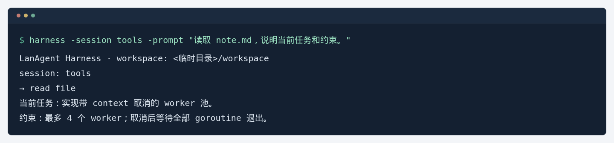
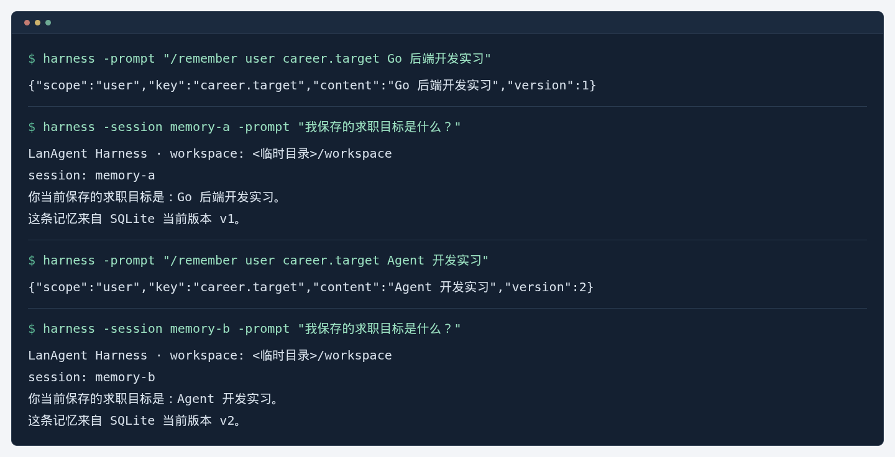
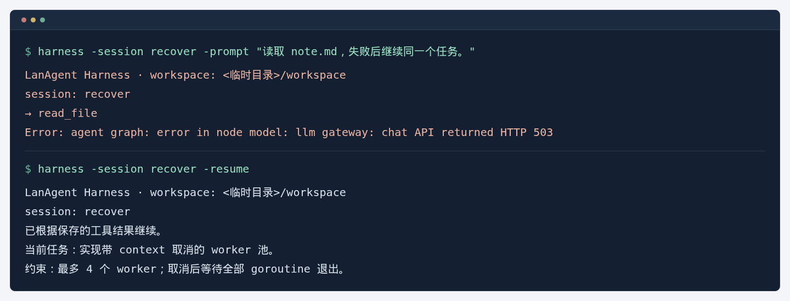
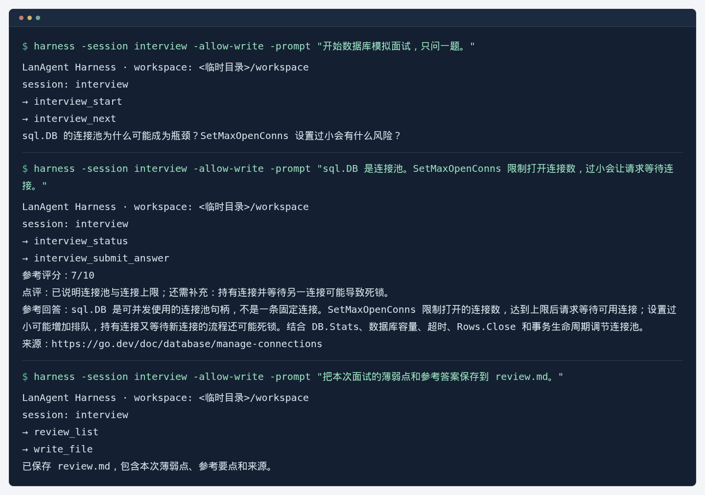
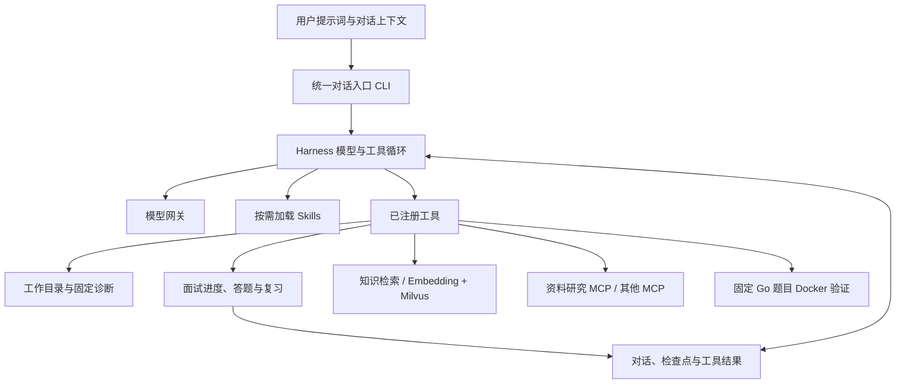

# LanAgent · Go Agent Harness 与面试训练系统

以 Go 构建可扩展、可恢复的 Agent Harness。用户在同一个对话入口中提出学习、模拟面试、资料研究或代码练习任务；模型结合提示词、对话上下文和已保存的进度选择 Skill 与工具。LangGraphGo 编排模型—工具循环，运行策略、工具权限和持久化由项目实现。

## 效果演示

下面四个示例运行实际 CLI，模型、Embedding 和 Milvus 使用本机固定替身，不需要密钥。文件读取、SQLite 和任务恢复使用项目代码；面试评分是固定样例。

**文件读取**

读取 `note.md`，根据文件内容回答。



**跨会话记忆**

保存求职目标后，开启新会话读取。随后修改同一条记忆，再开一个会话，读取到的是更新后的目标。



**中断恢复**

文件读取完成后，让下一次模型请求返回 503。使用 `-resume` 继续；脚本核对恢复前后的日志，文件读取均只执行了一次。



**模拟面试**

提交一道连接池问题的答案，显示点评、程序维护的参考答案和引用，并保存复盘文件。



图中省略公共配置参数，临时路径和随机标识已归一化；记忆 JSON 只显示主要字段。更新图片运行 `npm run demo:images`，具体步骤见[演示图维护指南](docs/demo-images.md)。

## 功能

- **执行核心**：模型/工具循环、SSE 工具参数重组、有界并发、取消、超时和调用预算；模型 HTTP 429/502/503/504 有限退避重试，工具副作用不自动重放。
- **意图分流**：默认规则模式，明确直答支持多轮上下文；可选独立分类模型，超时或格式不兼容时保留 ReAct，路由随检查点恢复。
- **执行追踪**：任务、分类、摘要、模型尝试和工具 span；JSONL 记录路由来源、排队耗时、重试及已报告用量，恢复后按运行 ID 汇总，缺失用量标为未知。
- **工具与扩展**：工作目录读取，显式开启的版本检查写入和固定诊断命令，MCP stdio/Streamable HTTP 白名单客户端，Skills 按需披露。
- **上下文**：保护当前目标与系统规则，成对处理工具调用/结果，历史摘要失败回退裁剪，保留测试哈希和状态等关键字段。
- **恢复**：成功会话与未完成执行分开存储，在模型/工具边界保存检查点；已完成调用复用结果，不确定执行由人工核对。
- **知识与面试**：官方 Go / Redis / PostgreSQL 文档采集、来源清单、Embedding、Milvus 检索；16 道基础题、有限追问、结构化反馈、待答题续接及薄弱点复习；面试进度作为对话中的工具状态保存，中途讲解或查资料后可以继续原题。
- **按需查询网页**：自行抓取 Go / Redis / PostgreSQL 官方文档，SQLite 全文搜索；模型按问题选择工具，再读取页面核实，不需要搜索服务商 Key。支持 `-web-policy off`。见[接入与刷新说明](docs/official-web.md)。
- **个人记忆**：SQLite WAL 保存显式用户/项目记忆，支持纠正、删除与跨会话读取；可选独立 Milvus 索引与 Outbox 同步，召回后回查当前版本。见[个人记忆说明](docs/personal-memory.md)。
- **Go 沙箱**：固定编程题的 Docker 测试，禁网、非 root、只读挂载和资源限制，测试证据绑定代码哈希。



面试、讲解和资料研究共享同一条对话与执行循环。Skill 描述操作步骤，工具维护题目、用户答案和进度；用户可以说“这题不懂，先讲一下”“找点资料”，再说“继续刚才的面试”。面试答案点评是工具内部的一次结构化模型请求。

## 快速开始

需要 Go 1.26 或更新版本，及支持工具调用与 SSE 的 OpenAI Compatible Chat Completions 服务。首次使用通过向导填写 Base URL、Key 和模型名：

```bash
git clone https://github.com/lannokaede/LanAgent.git
cd LanAgent
go run ./cmd/setup
go run ./cmd/harness -workspace . -prompt '读取 README.md，说明项目结构'
```

`setup` 支持逐项填写，或用 `go run ./cmd/setup -import -` 一次粘贴整段配置，最后输入 `/save`。Key 在终端隐藏输入；保存前执行一次最小 SSE 连通性检查。模型名留空时尝试读取服务端模型列表。

配置存入用户配置目录的 `lanagent/api.local.json`（Linux 通常为 `~/.config/lanagent/api.local.json`，文件权限 0600），各入口共享读取。优先级：环境变量 > 项目 `config.local.yaml` > 用户共享 API > 项目基础配置。旧私有配置可通过 `go run ./cmd/setup -from-config PRIVATE_CONFIG_DIR` 迁移。详见 [模型 API 接入](docs/model-api-setup.md)。

默认轻量配置仅需要聊天模型。也可继续使用 `LLM_BASE_URL`、`LLM_MODEL`、`LLM_API_KEY` 环境变量；`.env.example` 仅是示例，不自动加载。

### 交互启动与会话选择

```bash
# 在终端直接启动菜单
go run ./cmd/harness
# 显式进入菜单；也可指定自己的会话目录
go run ./cmd/harness -menu
```

菜单提供“新建对话 / 选择历史会话 / 启动设置”。历史列表按更新时间排序，显示首条消息标题、工作目录和已保存/未完成/需核对状态；输入序号选择，`n/p` 翻页，`/关键词` 搜索。会话退出后返回菜单，`0` 退出程序。

启动设置可以选择轻量资源或知识/面试资源、自定义工作目录、切换文件写入与固定诊断权限、填写 MCP 配置、绑定代码题和调整任务期限。每个会话保存自己的启动配置，选中后先展示权限与 MCP 设置，再继续或恢复；新启动的默认菜单会沿用最近会话设置。配置文件中的 Key 与 Token 不复制进会话启动记录。

聊天时输入 `/menu` 或 `/sessions` 可回到会话管理；`/help` 查看交互命令。已有会话切换时先释放原会话锁。旧会话缺少启动记录时可手动补齐原配置；不确定操作仍走核对流程。

带显式参数或管道输入时保持普通命令行为，脚本可继续使用：

```bash
# 交互模式；按需开启写入和固定诊断命令
go run ./cmd/harness -workspace . -allow-write -allow-commands
# 继续已完成会话
go run ./cmd/harness -workspace . -session SESSION_ID
# 恢复未完成任务，保留原来的工具开关和配置
go run ./cmd/harness -workspace . -session SESSION_ID -resume
# 加载自己的 MCP 服务白名单
go run ./cmd/harness -workspace . -mcp-config examples/harness/mcp.example.json
```

交互命令包括 `/menu`、`/sessions`、`/help`、`/exit`、`/paste`、`/status`、`/resume`、`/resolve`、`/discard`。文件写入需提供当前文件 SHA-256；固定诊断命令支持 Go 版本、Git 状态和差异。Skills 放在 `.lanagent/skills/<name>/SKILL.md`，启动时只向模型披露元数据，相关时调用 `load_skill` 读取正文。

完整权限、预算、摘要和恢复语义见 [Harness 使用说明](docs/personal-harness.md)。

### 可复现验收

```bash
# 本地替身、SQLite、CLI 集成与失败恢复，无模型或向量服务费用
./scripts/verify-harness.sh -mode offline
# 真实模型 / Embedding / Milvus / Docker；使用单独的验收集合和会话
ROUTER_MODEL=YOUR_SCHEMA_COMPATIBLE_MODEL \
  ./scripts/verify-harness.sh -mode all -config configs/interview \
  -milvus-url http://127.0.0.1:19530
```

报告输出到 `.runtime/harness-validation/report.json` 和同名 Markdown。混合分类需要支持严格 JSON Schema 的模型；可通过 `ROUTER_MODEL` 选择现有网关中的兼容模型，默认仍为无需分类调用的规则模式。验收证据、语料数量依据及简历条目对应关系见 [Harness 验证记录](docs/harness-validation.md)。

### 按需查询官方网页

```bash
mkdir -p bin
go build -o bin/lanagent-research-mcp ./cmd/research-mcp
./bin/lanagent-research-mcp index refresh -data-dir .runtime/research
go run ./cmd/harness -workspace . \
  -mcp-config examples/harness/official-web-mcp.example.json -timeout 3m \
  -prompt '搜索 Go 官方文档，读取页面核实 context 的取消机制，给出来源'
```

搜索查询本地站点索引，核实当前内容时再抓取网页；普通对话可以直接回答。首版覆盖三个官方站点，不是全网搜索。刷新部分失败时已完成页面仍可搜索。关闭网页工具使用 `-web-policy off`；该参数不关闭聊天模型等其他网络连接。详见[网页搜索说明](docs/official-web.md)。

## 面试知识库

使用自己可访问的 Milvus REST 服务，配置 `configs/interview/config.yaml` 中的地址和集合。Embedding 与聊天模型分开配置，可用 `go run ./cmd/setup -kind embedding` 接入。目前适配 `text-embedding-v4`，示例为 1024 维；其他模型需要扩展适配器并使用新集合，查询与索引须使用相同模型及维度。

```bash
export EMBEDDING_API_KEY='YOUR_EMBEDDING_API_KEY'
mkdir -p .runtime/corpora
go run ./cmd/knowledge crawl -dir .runtime/corpora/go-backend
go run ./cmd/knowledge import-corpus -config configs/interview -dir .runtime/corpora/go-backend
# 进入同一对话入口，启用知识检索与面试工具
go run ./cmd/harness -config configs/interview -workspace .
# 继续上次输出的同一会话 ID
go run ./cmd/harness -config configs/interview -workspace . -session SESSION_ID
```

进入后直接用自然语言交流：

```text
帮我模拟 3 题 Go 并发面试，一问一答。
这题不懂，先查官方资料讲一下。
继续刚才的题目。
无缓冲 channel 的发送和接收建立同步关系……
总结一下我的薄弱点。
```

模型根据当前请求和上下文选工具，程序保留当前题目和真实答题记录。讲解和查资料无需切换程序，也不会由固定交互循环自动推进题目。长答案可先输入 `/paste`，以单独一行 `/submit` 提交全文。

`configs/interview` 用来启用 Embedding/Milvus 资源，不是面试模式开关；同一启动配置下仍可读取文件、自由问答、调用 MCP 和绑定的代码题工具。默认 `configs/harness` 是无需向量库的轻量配置。

`cmd/interview` 保留为兼容启动名：它把初始面试请求交给相同的对话入口，不再维护独立交互循环。旧独立面试 JSON 文件保留原样，新的 `-session` 参数使用统一会话 ID。详见 [知识库与统一面试训练](docs/knowledge-and-interview.md)。

## 隔离代码练习

```bash
docker build -t lanagent/practice-go:1.26.9-v1 deployments/practice
go run ./cmd/harness -config configs/interview -workspace . \
  -exercise context-cancel/v1 -timeout 3m \
  -prompt '检索 context 取消的资料，解释题目并给出实现，使用沙箱验证，失败时修正后再测'
```

内置 `context-cancel/v1`、`concurrent-collect/v1`、`worker-exit/v1`，测试与题目契约由服务端固定。每次 CLI 调用最多测试两次；工作目录诊断工具与 Docker 用户代码执行各自有权限边界。

## 目录与检查

| 目录 | 用途 |
| --- | --- |
| `cmd/setup` | API 配置向导、粘贴导入与连通性检查 |
| `cmd/harness`、`internal/cli` | 统一对话入口，按提示词与上下文调度工具 |
| `cmd/interview` | 相同对话入口的面试启动别名 |
| `cmd/knowledge` | 采集、预处理、导入、检索与显式维护 |
| `internal/harness` | 执行图、上下文策略、检查点边界 |
| `internal/personal` | 本地会话、锁、恢复和人工核对 |
| `internal/workspace`、`internal/extension` | 文件工具、Skills 与 MCP 客户端 |
| `internal/corpus`、`internal/rag`、`internal/interview` | 知识处理、面试状态工具与内置 Skill |
| `internal/practice`、`examples/practice` | 固定 Go 题目、检查与 Docker 执行 |

```bash
go test ./...
go test -race ./...
go vet ./...
# 需要本机 Docker 与已构建镜像；模型侧使用本地替身
PRACTICE_DOCKER_TEST=1 go test ./cmd/harness -run '^TestPersonalExerciseDockerPath$' -v -count=1
```

运行数据默认写入用户缓存目录或 `.runtime/`。会话中可能包含输入与工具结果，已从版本控制排除。仓库提供可重建的资料采集程序和题目，不包含个人会话、向量数据库快照、密钥或简历材料。

## 来源

项目早期学习结构参考 [nexus-agent](https://github.com/chengpeng-cp/nexus-agent)，后续聚焦个人 Harness 和 Go 面试训练。运行编排使用 [LangGraphGo](https://github.com/smallnest/langgraphgo)，模型适配使用 LangChainGo，MCP 使用官方 Go SDK。来源记录见 [NOTICE.md](NOTICE.md)。

## 资料研究 MCP

同库提供可独立构建的 `cmd/research-mcp`，包含资料抓取、工件读取、候选准备、知识入库与持久任务。默认官方文档模式不需要爬虫账号；联网搜索可接 Firecrawl，正式入库需显式开启。见[运行与部署](docs/research-mcp.md)及[工具设计](docs/tooling-design.md)。
