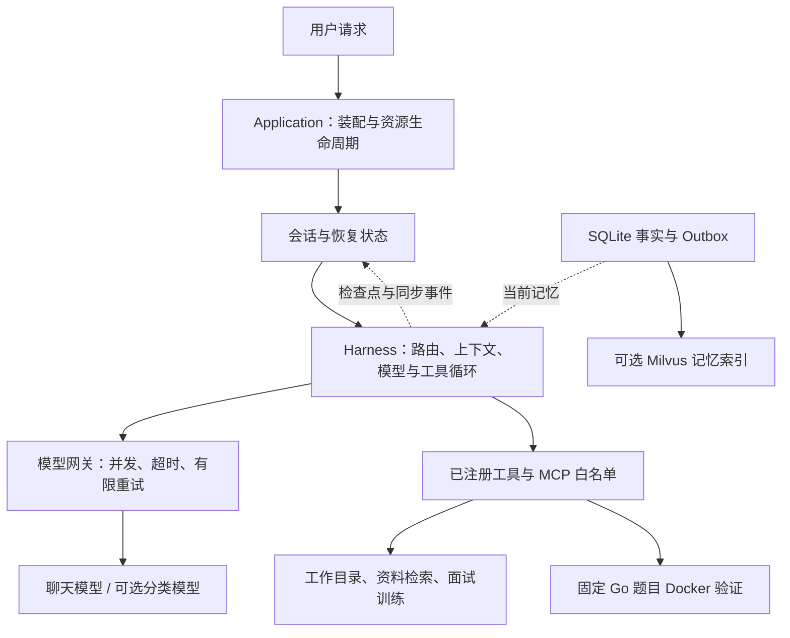

# LanAgent · Go Agent Harness 与面试训练系统

面向技术资料研究、Go 面试训练和代码验证的个人 Agent 执行框架。用户在统一 CLI 中提出任务，模型选择工具，宿主控制权限、执行预算、状态持久化和中断恢复。

LangGraphGo 负责模型—工具循环；项目实现模型调用策略、工具执行约束、会话恢复和记忆同步。面试与资料研究作为工具接入同一执行流程。

[快速开始](#快速开始) · [工程设计](docs/architecture.md) · [验收记录](docs/harness-validation.md) · [完整使用说明](docs/personal-harness.md)

## 核心设计

| 遇到的问题 | 实现中的约束 | 代码与验证 |
| --- | --- | --- |
| 模型可能给出错误参数或连续调用工具 | 注册表固定能力；白名单、Schema 校验、模型轮次与工具调用预算约束执行 | [执行核心](internal/harness)、[工具策略测试](internal/harness/policy_test.go) |
| 请求中断时，工具可能已经产生效果 | 执行前保存标记，结果完成后保存观察；恢复时复用已完成结果，未知结果先核对收据 | [会话恢复](internal/personal/recovery.go)、[恢复测试](internal/personal/recovery_test.go) |
| 记忆已纠正，但向量库仍返回旧内容 | SQLite 保存事实，事务 Outbox 同步索引；召回后回查版本与删除状态 | [记忆模块](internal/personalmemory)、[一致性测试](internal/personalmemory/service_test.go) |
| 模型接口限流，重试又可能放大负载 | 共享并发槽位，有界退避；退避释放槽位，所有尝试共享调用期限 | [模型网关](internal/llm/gateway.go)、[重试测试](internal/llm/retry_test.go) |
| 长对话与摘要故障影响后续执行 | 按完整工具消息组裁剪，保留目标与验证字段；摘要失败回退裁剪 | [上下文处理](internal/harness/context.go)、[上下文测试](internal/harness/context_test.go) |

这些约束落实在宿主代码中。规则与可选分类模型决定回答路径，工具权限由注册表和适配器独立检查。完整取舍、失败处理和状态提交顺序见[工程设计](docs/architecture.md)。

## 运行结构



会话快照保存已完成对话，Checkpoint 保存未完成执行，JSONL 保存执行轨迹与模型请求统计。SQLite 保存当前记忆事实，Milvus 提供语义召回候选。各类状态的职责与提交点见[状态流转](docs/architecture.md#状态与提交顺序)。

## 快速开始

默认配置只需要 Go 1.26 或更新版本，以及支持工具调用与 SSE 的 OpenAI Compatible Chat Completions 服务。

```bash
git clone https://github.com/lannokaede/LanAgent.git
cd LanAgent
go run ./cmd/setup
go run ./cmd/harness -workspace . -prompt '读取 README.md，说明项目结构'
```

`setup` 隐藏输入 Key，保存前检查最小 SSE 调用。配置优先级为：环境变量 → 项目 `config.local.yaml` → 用户共享 API 配置 → 项目基础配置。配置路径、导入方式和连通性排查见[模型 API 接入](docs/model-api-setup.md)。

```bash
# 终端交互菜单：新建会话、选择历史会话、调整启动设置
go run ./cmd/harness
# 恢复未完成任务，保留原工作目录和工具权限
go run ./cmd/harness -workspace . -session SESSION_ID -resume
```

### 按需启用能力

| 场景 | 启用方式 | 依赖与说明 |
| --- | --- | --- |
| 阅读工作目录 | 默认启用 | 文件工具通过 `os.Root` 限定目录；[文件与权限](docs/personal-harness.md#文件命令与-skills) |
| 写文件或运行固定诊断 | `-allow-write`、`-allow-commands` | 写入检查原文件哈希；诊断只接受固定动作 |
| 个人记忆 | `/remember`、`/memory`、`/forget` | SQLite 默认启用；语义索引通过 `-memory-vectors` 显式开启；[记忆说明](docs/personal-memory.md) |
| 知识检索与面试训练 | `-config configs/interview` | 需要匹配的 Embedding 与 Milvus 集合；[知识库与面试](docs/knowledge-and-interview.md) |
| 官方资料搜索与核实 | `-mcp-config examples/harness/official-web-mcp.example.json` | 搜索本地官方站点索引，再抓取页面核实；[构建与刷新](docs/official-web.md) |
| Go 代码验证 | `-exercise context-cancel/v1` | 需要 Docker 和固定练习镜像；[沙箱说明](docs/knowledge-and-interview.md) |
| 可选模型分类与追踪 | 项目本地配置中的 `routing`、`telemetry` | 默认规则分流；分类故障回退 ReAct；[配置与行为](docs/personal-harness.md) |

MCP 支持 stdio 和 Streamable HTTP。每个服务声明工具白名单，连接身份参与恢复校验。Skills 启动时只加载元数据，需要时才读取正文。交互命令、权限、摘要和恢复操作见[完整使用说明](docs/personal-harness.md)。

### 构建知识库与练习镜像

```bash
# 采集官方资料并导入指定知识库；需要配置 Embedding 和 Milvus
go run ./cmd/knowledge crawl -dir .runtime/corpora/go-backend
go run ./cmd/knowledge import-corpus -config configs/interview -dir .runtime/corpora/go-backend
go run ./cmd/harness -config configs/interview -workspace .

# 预先构建固定 Go 练习环境
docker build -t lanagent/practice-go:1.26.9-v1 deployments/practice
go run ./cmd/harness -workspace . -exercise context-cancel/v1 -timeout 3m
```

面试工具维护题目、真实答案和进度；用户可以在答题、解释和资料检索之间切换，再继续原题。Go 沙箱使用固定题目及服务端测试，结果绑定代码哈希。

## 可复现验证

```bash
go test ./...
go test -race ./...
go vet ./...

# 无浏览器、无外部模型或向量服务的集成验收
./scripts/verify-harness.sh -mode offline
```

真实服务验收读取已有配置，使用独立工作目录、SQLite 数据库和临时向量集合：

```bash
ROUTER_MODEL=YOUR_SCHEMA_COMPATIBLE_MODEL \
  ./scripts/verify-harness.sh -mode all -config configs/interview \
  -milvus-url http://127.0.0.1:19530 \
  -report .runtime/harness-validation/acceptance.json
```

报告区分离线测试、真实调用、失败和未执行场景。已完成的代表性验证包括：

- 文件读取后连续注入 3 次 HTTP 503，再恢复原任务；恢复前后的 `read_file` 调用次数均为 1。
- 记忆纠正或删除后重新引入旧向量，召回仍依据 SQLite 当前状态过滤。
- 真实模型调用 Docker 工具执行给定代码，返回固定测试结果及对应代码哈希。

测试环境、完整结果、模型兼容性和 17 份文档 / 1,206 个片段的快照依据见[验收记录](docs/harness-validation.md)。这些记录对应功能和失败场景；容量、检索质量及费用收益需要另行评测。

## 从哪里读代码

| 阅读目标 | 建议入口 |
| --- | --- |
| 一次请求怎样进入执行循环 | [`internal/application/runtime.go`](internal/application/runtime.go) → [`internal/personal/session.go`](internal/personal/session.go) → [`internal/harness/runner.go`](internal/harness/runner.go) |
| 模型请求怎样排队、重试和停止 | [`internal/llm/gateway.go`](internal/llm/gateway.go) → [传输适配](internal/llm/openai_compatible.go) → [SSE 处理](internal/llm/stream.go) |
| 中断后如何判断能否继续 | [`internal/harness/checkpoint.go`](internal/harness/checkpoint.go) → [`internal/personal/recovery.go`](internal/personal/recovery.go) → [收据核对](internal/extension/reconcile.go) |
| 记忆怎样保存、同步和校验 | [`internal/personalmemory/store.go`](internal/personalmemory/store.go) → [`service.go`](internal/personalmemory/service.go) → [`milvus.go`](internal/personalmemory/milvus.go) |
| 验证怎样复现 | [`internal/acceptance`](internal/acceptance)、[测试与验收矩阵](docs/architecture.md#验证方式) |

## 运行演示

以下示例运行实际 CLI，模型、Embedding 和 Milvus 使用本机固定替身；文件读取、SQLite、会话持久化和恢复使用项目实现。

<details>
<summary>展开文件读取、跨会话记忆、中断恢复与模拟面试演示</summary>

**文件读取**：读取 `note.md`，根据文件内容回答。


**跨会话记忆**：保存求职目标后开启新会话，再修改记忆并读取更新后的目标。


**中断恢复**：文件读取后模拟模型故障，使用 `-resume` 续跑，日志核对文件读取次数。


**模拟面试**：提交连接池问题的答案，显示固定样例点评与引用，并保存复盘文件。


图中临时路径、时间和标识已归一化。更新图片运行 `npm run demo:images`，步骤见[演示图维护指南](docs/demo-images.md)。

</details>

## 适用范围

会话绑定本地工作目录，进程锁保证同一会话排他访问；向量同步 worker 由当前 CLI 进程托管。记忆索引采用最终一致，召回时检查事实版本。第三方写操作结果不确定时保留待核对状态，自有研究 MCP 支持按操作收据找回已接收任务。

Docker 验证限定在固定 Go 题目、资源与执行策略内；MCP 服务拥有其进程自身的权限。运行数据、个人配置和完整会话保存在用户缓存目录或 `.runtime/`，不提交到仓库。

独立的 `cmd/research-mcp` 提供资料抓取、工件读取、候选准备、知识入库和持久任务，可通过 stdio 或 HTTP 接入。见[研究 MCP](docs/research-mcp.md)。

## 来源

项目早期学习结构参考 [nexus-agent](https://github.com/chengpeng-cp/nexus-agent)。运行编排使用 [LangGraphGo](https://github.com/smallnest/langgraphgo)，模型适配使用 LangChainGo，MCP 使用官方 Go SDK。依赖版本以 [go.mod](go.mod) 为准，来源与许可记录见 [NOTICE.md](NOTICE.md)。
