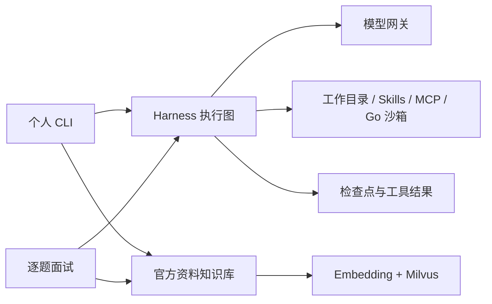

# LanAgent · Go Agent Harness 与面试训练系统

以 Go 构建可扩展、可恢复的 Agent 运行时，并以 Go 后端学习、模拟面试与代码练习作为应用场景。LangGraphGo 编排模型—工具循环，运行策略、工具权限和持久化由项目实现。

## 功能

- **执行核心**：模型/工具循环、SSE 工具参数重组、有界并发、取消、超时和调用预算。
- **工具与扩展**：工作目录读取，显式开启的版本检查写入和固定诊断命令，MCP stdio/Streamable HTTP 白名单客户端，Skills 按需披露。
- **上下文**：保护当前目标与系统规则，成对处理工具调用/结果，历史摘要失败回退裁剪，保留测试哈希和状态等关键字段。
- **恢复**：成功会话与未完成执行分开存储，在模型/工具边界保存检查点；已完成调用复用结果，不确定执行由人工核对。
- **知识与面试**：官方 Go / Redis / PostgreSQL 文档采集、来源清单、Embedding、Milvus 检索；16 道基础题、有限追问、结构化反馈、待答题续接及薄弱点复习。
- **Go 沙箱**：固定编程题的 Docker 测试，禁网、非 root、只读挂载和资源限制，测试证据绑定代码哈希。



## 快速开始

需要 Go 1.26 或更新版本，及支持工具调用的 OpenAI Compatible Chat Completions 服务。在终端设置自己的模型配置：

```bash
git clone https://github.com/lannokaede/LanAgent.git
cd LanAgent
export LLM_BASE_URL='https://YOUR_OPENAI_COMPATIBLE_HOST/v1'
export LLM_MODEL='YOUR_CHAT_MODEL'
export LLM_API_KEY='YOUR_API_KEY'
go run ./cmd/harness -workspace . -prompt '读取 README.md，说明项目结构'
```

默认个人模式仅需要模型服务。可在忽略的 `configs/harness/config.local.yaml` 中配置 `llm.base_url`、`llm.model`、`llm.api_key`；环境变量优先。`.env.example` 仅是示例，程序不会自动加载 `.env`。

```bash
# 交互模式；按需开启写入和固定诊断命令
go run ./cmd/harness -workspace . -allow-write -allow-commands
# 继续已完成会话
go run ./cmd/harness -workspace . -session SESSION_ID
# 恢复未完成任务，保留原来的工具开关和配置
go run ./cmd/harness -workspace . -session SESSION_ID -resume
# 加载自己的 MCP 服务白名单
go run ./cmd/harness -workspace . -mcp-config examples/harness/mcp.example.json
```

交互命令包括 `/exit`、`/status`、`/resume`、`/resolve`、`/discard`。文件写入需提供当前文件 SHA-256；固定诊断命令支持 Go 版本、Git 状态和差异。Skills 放在 `.lanagent/skills/<name>/SKILL.md`，启动时只向模型披露元数据，相关时调用 `load_skill` 读取正文。

完整权限、预算、摘要和恢复语义见 [Harness 使用说明](docs/personal-harness.md)。

## 面试知识库

使用自己可访问的 Milvus REST 服务，配置 `configs/interview/config.yaml` 中的地址和集合。Embedding 与聊天模型分开配置：默认示例为 `text-embedding-v4`、1024 维，可更换兼容服务，但查询与索引须使用相同模型及维度。

```bash
export EMBEDDING_API_KEY='YOUR_EMBEDDING_API_KEY'
mkdir -p .runtime/corpora
go run ./cmd/knowledge crawl -dir .runtime/corpora/go-backend
go run ./cmd/knowledge import-corpus -config configs/interview -dir .runtime/corpora/go-backend
go run ./cmd/interview -topic concurrency -questions 3
# 使用上次输出的状态文件继续，主题保持一致
go run ./cmd/interview -topic concurrency -session .runtime/interviews/SESSION.json
```

逐题作答支持多行，以单独一行 `/submit` 提交。反馈后按需要追问一次，复习记录保存为 `*-review.md`。配置知识库后，也可运行 `go run ./cmd/harness -config configs/interview -workspace .` 自由检索和问答。详见 [知识库与面试训练](docs/knowledge-and-interview.md)。

## 隔离代码练习

```bash
docker build -t lanagent/practice-go:1.26.9-v1 deployments/practice
go run ./cmd/harness -config configs/interview -workspace . \
  -exercise context-cancel/v1 -timeout 3m \
  -prompt '检索 context 取消的资料，解释题目并给出实现，使用沙箱验证，失败时修正后再测'
```

内置 `context-cancel/v1`、`concurrent-collect/v1`、`worker-exit/v1`，测试与题目契约由服务端固定。每次 CLI 调用最多测试两次；工作目录诊断工具与 Docker 用户代码执行各自有权限边界。

## 目录与检查

| 目录 | 用途 |
| --- | --- |
| `cmd/harness` | 个人工作目录与学习入口 |
| `cmd/interview` | 逐题训练、追问与复习 |
| `cmd/knowledge` | 采集、预处理、导入、检索与显式维护 |
| `internal/harness` | 执行图、上下文策略、检查点边界 |
| `internal/personal` | 本地会话、锁、恢复和人工核对 |
| `internal/workspace`、`internal/extension` | 文件工具、Skills 与 MCP 客户端 |
| `internal/corpus`、`internal/rag`、`internal/interview` | 知识与训练流程 |
| `internal/practice`、`examples/practice` | 固定 Go 题目、检查与 Docker 执行 |

```bash
go test ./...
go test -race ./...
go vet ./...
# 需要本机 Docker 与已构建镜像；模型侧使用本地替身
PRACTICE_DOCKER_TEST=1 go test ./cmd/harness -run '^TestPersonalExerciseDockerPath$' -v -count=1
```

运行数据默认写入用户缓存目录或 `.runtime/`。会话中可能包含输入与工具结果，已从版本控制排除。仓库提供可重建的资料采集程序和题目，不包含个人会话、向量数据库快照、密钥或简历材料。

## 来源

项目早期学习结构参考 [nexus-agent](https://github.com/chengpeng-cp/nexus-agent)，后续聚焦个人 Harness 和 Go 面试训练。运行编排使用 [LangGraphGo](https://github.com/smallnest/langgraphgo)，模型适配使用 LangChainGo，MCP 使用官方 Go SDK。来源记录见 [NOTICE.md](NOTICE.md)。
