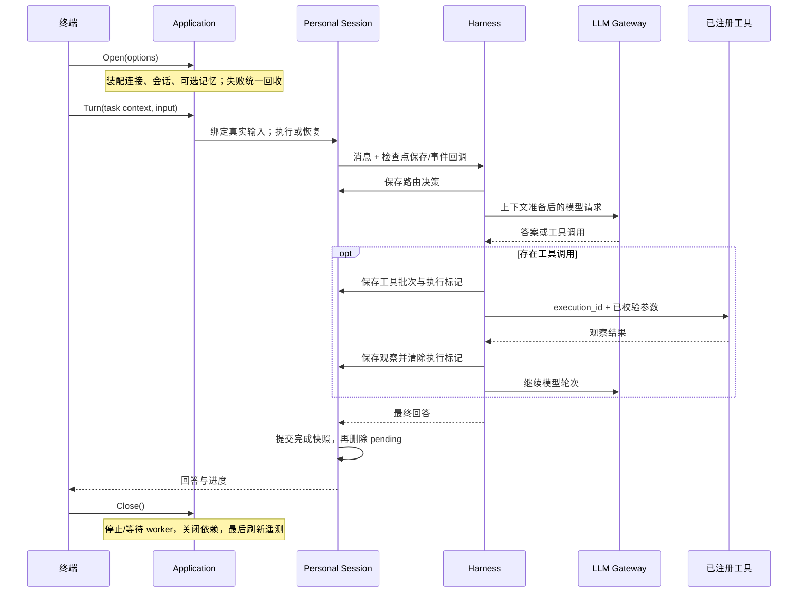

# 执行架构与维护指南

LanAgent 将模型决策和宿主执行分开：模型可以提出回答或工具调用，宿主决定哪些调用能够执行、何时保存状态，以及失败后能否继续。核心链路围绕五件事组织：有界执行、上下文预算、记忆一致性、执行恢复、模型请求治理。

[项目入口](../README.md) · [使用说明](personal-harness.md) · [验收记录](harness-validation.md)

## 目录与职责

| 目录 | 负责什么 | 调用者需要了解的接口 |
| --- | --- | --- |
| `cmd/harness`、`cmd/interview` | 进程入口、信号和退出码；两个命令使用同一 CLI | `cli.Run` |
| `internal/cli` | 参数、终端菜单、多行输入、进度和错误展示 | 调用 application；不持有模型、数据库或后台 worker |
| `internal/application` | 一次会话的配置装配、工具绑定、资源所有权和关闭顺序 | `Open` → `Turn` / 恢复操作 → `Close`；本地记忆命令独立进入 |
| `internal/personal` | 已完成对话、未完成任务、会话锁、原始输入绑定和 JSONL | `Session.Turn`、`Resume`、`Resolve`；会话绑定工作目录 |
| `internal/harness` | 规则/分类路由、上下文准备、模型—工具循环、工具策略、检查点 | `Runner` 注入 Provider 与 Registry；每次执行使用独立状态 |
| `internal/llm` | 模型协议、HTTP/SSE 适配、并发、超时、有限重试和调用元数据 | `Provider` / `StreamProvider`、共享 `Gateway` |
| `internal/contextbudget` | 预算估算与按完整工具消息组裁剪 | 纯输入输出，不读取个人配置或会话文件 |
| `internal/tool`、`workspace`、`extension` | 工具协议、目录内文件操作、Skills、MCP 白名单与收据核对 | 注册后的名称与 Schema；外部服务保持独立权限 |
| `internal/personalmemory` | SQLite 当前事实、操作回执、Outbox、租约与向量召回过滤 | 显式命令、`Recall`、可取消同步 worker |
| `internal/rag` | 文档切分、Embedding、向量入库与检索 | `Engine` 接受 Embedder/Store；配置构造的 Engine 统一关闭资源 |
| `internal/interview`、`practice` | 题目与真实答案、训练进度、固定 Go 题的 Docker 验证 | 工具接入，不改变 Harness 主循环 |
| `internal/acceptance` | 离线/真实场景编排、隔离目录与集合、报告与语料核验 | `Run(ctx, Options, progress)`；命令只解析参数与信号 |
| `internal/research`、`cmd/research-mcp` | 官方资料抓取、工件、候选、知识导入及持久任务 | 通过 MCP 工具接入；见[研究 MCP](research-mcp.md) |

新增能力时，先确定状态归属和失败后的处理方式。例如，新增模型供应商应实现 Provider；新增外部动作应注册工具。业务工具不需要在 CLI 或模型循环中增加分支。配置读取集中在装配入口，执行核心通过参数获得策略。

核心依赖检查位于 [`internal/architecture`](../internal/architecture/dependencies_test.go)，只约束 Harness、LLM、上下文预算三个包的直接内部依赖，防止它们反向读取 CLI 或个人配置。检查随 `go test ./...` 执行。

## 一次请求的路径



`application.Runtime` 按串行会话使用：等待当前 Turn 返回后再恢复、核对或关闭。多个独立会话可使用执行核心；同一持久会话由进程锁保护。菜单返回和重新进入会创建新的 Runtime，旧 Runtime 的幂等 Close 负责结束其资源。

资源按获取顺序登记，失败和正常退出使用同一逆序释放流程。记忆 worker 在首次普通任务时启动，本地记忆管理和收据核对不启动同步；关闭时先取消并等待 worker，再关闭索引和 SQLite。模型客户端、MCP 连接及会话锁也由 Runtime 持有。遥测使用新的 5 秒关闭上下文，避免任务取消直接跳过刷新。

## 路由与模型请求治理

默认采用规则；明确“不使用工具”的请求可在多轮中直答，仍使用历史、记忆与预算。文件动作、需要核实的网页信息、面试状态和不确定请求保留工具路径。混合模式只把有界近期原始历史与当前请求交给可选分类模型，不把召回记忆、工具结果当作分类指令。

分类超时、格式错误或严格结构化输出不兼容时回退 ReAct。直答请求不提供工具，若供应商仍返回调用则拒绝执行。决策在主模型调用前持久化；恢复沿用该决策，避免配置变化重新解释未完成任务。

模型网关同时覆盖流式、非流式、分类和摘要请求。三个计数分别描述不同工作：

- **模型轮次**：Harness 与主模型交互多少轮；默认 CLI 上限为 10。
- **HTTP 尝试次数**：同一次模型请求经过几次网络尝试；默认最多 3 次。
- **工具调用次数**：已进入执行的工具数量；CLI 的单任务上限为 20。

只有 HTTP 429、502、503、504 在未开始输出时重试，默认从 250ms 起指数退避并加入抖动，尊重 Retry-After。退避释放并发槽位；调用超时一旦开始便覆盖全部尝试和重新排队，仍受外层任务期限限制。SSE 已开始输出、解析错误、鉴权/参数错误、调用者回调失败、上下文取消均直接返回。工具操作不会借用模型重试机制重新执行。

## 状态与提交顺序

| 状态 | 权威内容 | 提交点与恢复规则 |
| --- | --- | --- |
| 会话 `*.json` | 已完成对话和最后完成的 run ID | 先写完成快照，再删除 pending；启动时识别已完成 run，避免重复提交 |
| `*.pending.json` | 未完成消息、模型阶段、剩余工具、路由与运行中执行 ID | 每个模型/工具边界保存；恢复前校验消息协议、阶段和待执行调用的一致性 |
| JSONL | 同步执行事件、模型尝试与供应商用量 | 记录失败会停止后续执行；用于本地审计与重启后的统计 |
| SQLite | 当前记忆事实、版本、删除标记、命令回执、Outbox | 同一事务提交；向量服务故障不会撤销已保存事实 |
| Milvus | 按版本生成的语义索引 | 异步更新；只返回候选，Recall 回查 SQLite 再接受 |
| OTel | 任务与子调用的元数据 span | 用于跨调用关联；导出不替代检查点或本地记录 |

工具执行遵守以下顺序：

1. 保存模型决策及待执行批次；在首个工具执行前检查整批调用预算。
2. 为下一个调用派生稳定 `execution_id`，将 Running 标记持久化。
3. 按次检查名称、参数大小和工具 Schema，执行合法调用；普通校验错误作为观察返回。
4. 将观察写入消息，移除该 Pending 调用、清除 Running，并保存检查点。
5. 输出工具结果事件，再继续后续调用或模型。

若第 3 步已产生效果但第 4 步没有成功落盘，宿主无法仅靠网络错误判断结果。恢复保持不确定状态，先通过原服务的执行收据、工具名与参数哈希核对；没有受支持收据时需要人工核对。项目不承诺跨任意第三方服务的 exactly-once 执行。

恢复校验拒绝“历史没有对应工具请求、Pending 却要求执行某工具”等损坏状态，并兼容旧 v1 检查点、合法的部分批次和工具批次已完成但尚未进入下一模型的边界。权限、MCP 身份、题目绑定等 profile 不匹配时拒绝继续。

## 记忆与上下文的取舍

记忆变更在 SQLite WAL 事务中同时写入事实、操作回执和 Outbox；worker 原子领取任务、持租约、失败退避。向量主键包含版本，延迟返回的旧 worker 不覆盖新版本。纠正和删除后，即使旧向量再次出现在候选中，Recall 仍检查当前事实、作用域、版本与删除状态。索引采用最终一致，worker 随当前应用进程运行；没有独立调度服务。

上下文预算先保留可信规则、当前目标与关键验证字段，再按完整 assistant/tool 消息组裁剪。摘要只压缩历史，生成失败回退裁剪；日志回调故障作为执行故障返回，避免误当摘要失败继续调用模型。Token 预算采用保守估算，费用与实际用量只使用供应商返回值，二者用途不同。

## 失败处理

| 故障 | 处理 | 验证位置 |
| --- | --- | --- |
| 分类超时或不支持 Schema | 回退工具路径，记录来源 | `internal/harness/hybrid_test.go` |
| 摘要生成失败 | 按完整工具组裁剪 | `internal/harness/context_test.go` |
| 429/502/503/504 | 满足边界时有限重试；期限内无法退避则返回 | `internal/llm/retry_test.go` |
| 流中断或事件回调失败 | 停止；不重复已输出的模型请求 | `internal/llm/stream_test.go`、`internal/personal/session_test.go` |
| 工具完成后的日志失败 | 结果检查点已保存，恢复不重放工具 | `internal/personal/recovery_test.go` |
| 未知工具副作用 | 暂停并核对原执行收据 | `internal/extension/reconcile_test.go` |
| 检查点内部矛盾 | 调用模型/工具前拒绝恢复 | `internal/harness/checkpoint_test.go` |
| 装配中途失败或菜单退出 | 统一回收资源、会话锁与 worker | `internal/application/runtime_test.go` |
| 向量同步失败或旧向量返回 | Outbox 重试；召回检查 SQLite 当前事实 | `internal/personalmemory/service_test.go` |

## 追踪与数据范围

一次执行有任务根 span，分类、摘要、模型尝试和工具为子 span。恢复创建新的执行尝试，通过稳定 `run_id` 关联原任务；工具使用稳定 execution ID 核对效果。JSONL 记录路由来源、尝试次数、排队和执行耗时、TTFT、状态及用量。分类、摘要进入统计，供应商没有返回的 Token 数保持未知。

OTel 和模型调用元数据不记录提示词、工具参数、正文或密钥。本地会话与原始工具事件承担对话持久化职责，可能包含用户内容；两类记录职责不同，均不应提交个人运行数据。

## 验证方式

```bash
go test ./...
go test -race ./...
go vet ./...
./scripts/verify-harness.sh -mode offline
```

CI 执行格式检查、普通测试、race 和 vet。测试使用真实模块配合受控 HTTP/MCP 替身，覆盖协议与失败边界；真实服务验收另行通过 `internal/acceptance.Run` 驱动 CLI，使用独立工作目录、SQLite 和临时 Milvus 集合，结束后清理。

真实服务报告区分通过、失败、未执行场景，记录请求次数、耗时和实际证据。已验证的文件读取后恢复、记忆过滤、摘要、Docker 及语料校验见[完整验收记录](harness-validation.md)。离线验证不代表真实服务可用，功能验收也不代表并发容量或检索质量评测。
