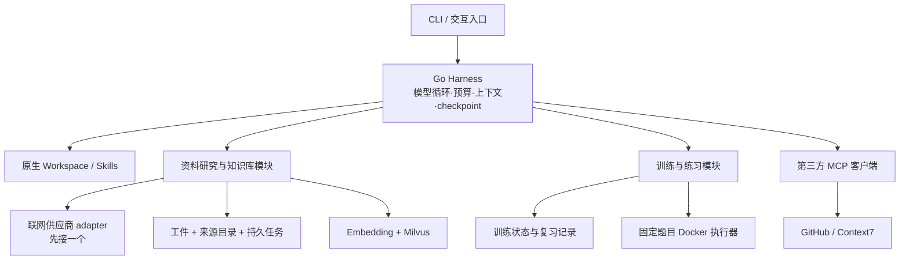

# LanAgent 工具体系与 MCP 适配方案

调研日期：2026-11-03。代码基线：`e3b031e`。本文是设计方案，明确区分现有能力、已有实现但尚未工具化的能力、待开发能力；本文件保留原调研基线；第一阶段已在后续实现，范围与实际限制以[研究 MCP 使用说明](research-mcp.md)为准，其余候选仍是规划。第三方兼容性调研见[配套研究](research/tool-ecosystem-2026-11-03.md)。

## 1. 建议的方向

把 LanAgent 做成“能够查资料、维护知识、验证代码、安排训练的 Go 后端学习与研究 Harness”。模拟面试是其中一个使用入口。最值得先形成的任务链是：

> 我最近总答不好 context 取消和 goroutine 泄漏。找一些近期面经，核对官方说明，把有价值的新内容补进知识库，给我一道相关代码题，运行后指出问题。

这需要模型根据已有观察决定是否搜索、哪些页面值得抓、资料是否重复、是否有足够依据、是否需要运行代码。Harness 负责工具权限、调用预算、上下文、状态和恢复；工具负责可核实的外部动作与结构化结果。

建议优先级：

| 层次 | 建议 | 原因 |
| --- | --- | --- |
| 第一阶段 P0 | 联网搜索与抓取、结果工件、候选资料检查、知识导入、任务查询与操作核对 | 先完成一次“发现新资料→有来源地入库→检索命中”的完整任务 |
| 第二阶段 P1 | 学习记录与训练状态工具、代码题目录与检查、GitHub/Context7、限定站点批量采集 | 让研究、项目讲解和代码练习围绕个人薄弱点工作 |
| 第三阶段 P2 | 文档解析、Go 编译诊断、profile 分析、必要时的浏览器交互 | 有实际任务和样本后再扩大运行环境 |

现成工具优先采用官方实现。自研重点放在“资料来源、知识生命周期、训练状态、执行证据”上。初期只引入一个联网供应商，保留 Milvus 和现有模型配置。

## 2. 当前代码真正具备什么

### 2.1 个人入口已实现的 7 项工具

这里统计的是 `cmd/harness` 能注册的不同工具类型，并非默认同时启用 7 项。默认只有文件列表和读取；其余依赖开关、配置、技能目录或题目绑定。

| ID | 工具名 | 启用条件 | 已有能力及限制 |
| --- | --- | --- | --- |
| E01 | `list_files` | 默认 | 工作目录内单层列举，至多 200 项；没有递归全文搜索 |
| E02 | `read_file` | 默认 | UTF-8 文本，32 KiB 分页，提供续读偏移；整文件一次读取才有完整文件哈希 |
| E03 | `write_file` | `-allow-write` | 至多 32 KiB，覆盖需要基准哈希；不支持任意补丁、删文件或创建父目录 |
| E04 | `run_command` | `-allow-commands` | 只有 `go_version`、`git_status`、`git_diff`；不是任意 Shell |
| E05 | `load_skill` | 找到有效 Skills | 按名称加载任务指导；技能不能增开工具权限 |
| E06 | `knowledge_search` | RAG 已启用且已有可用集合 | 固定知识库，向量检索 1–5 条候选，附来源和块序号；没有面经类型或时间筛选 |
| E07 | `run_go_exercise` | `-exercise id/version`，Docker 可用 | 固定题目、服务端测试、每次 CLI 最多两次；现有容器命令已经包含 `go test -race` |

依据：[个人入口](../cmd/harness/main.go)、[Workspace](../internal/workspace/workspace.go)、[文件与诊断动作](../internal/workspace/write.go)、[Skills](../internal/workspace/skills.go)、[知识工具](../internal/tool/knowledge.go)、[代码工具](../internal/practice/agent_sandbox.go)、[容器执行器](../internal/practice/docker.go)。示例 `add` 工具未接到个人入口，不算核心产品功能。

### 2.2 已有模块，但还没有成为个人 Agent 工具

| 现有模块 | 可以复用什么 | 还需要补什么 |
| --- | --- | --- |
| `internal/corpus`、`cmd/knowledge crawl` | 官方网页提取、robots、限速、manifest、内容哈希 | 当前只采集 17 个固定官方种子；没有搜索发现、面经来源策略、Agent 工具封装 |
| `cmd/knowledge prepare/import/import-corpus` | UTF-8 文本分块、批量向量化、写 Milvus、版本检查 | 分离候选准备与正式入库；增加持久任务和工具结果 |
| `internal/rag/catalog.go` | 文档列表、删除实现 | 列表通过向量行聚合且有条数上限，不是完整来源目录；删除暂不开放给 Agent |
| `internal/rag/manager.go` | 有界队列、串行写入 | 当前任务记录在内存，不能直接充当可重启恢复的爬取/导入任务系统 |
| `internal/interview`、`cmd/interview` | 16 道基础题、单题交互、依据检索、答案反馈、最多一次追问、保存复习记录 | 当前反馈请求没有可调用工具；没有动态题库、Agent 读取薄弱点或安排复习的工具 |
| `internal/practice` | 3 道固定练习、题目目录、AST/约定检查、Docker 测试 | 目录读取和执行前检查尚未独立成为个人工具；检查当前依赖固定题目约定 |
| `internal/extension` | stdio / Streamable HTTP、明确工具白名单、本地输入 Schema 校验、稳定别名 | 尚未提供领域 MCP 服务端、Resources/Prompts 接入、输出 Schema 校验或持久任务接续 |

现有 MCP 工具别名为 `mcp_<20位十六进制>`，描述保留远端服务器与原工具名。下文清单中的新名称是领域设计名；接成 MCP 后模型实际收到的名称仍由此规则生成，不可把两者混用。

### 2.3 扩展必须尊重的运行时约束

现有工具接口为 `Spec()` 与 `Execute(ctx, argsJSON)`；注册表在启动时固定，运行中不动态注册。默认每任务 10 轮模型请求、20 次工具调用、工具期限 65 秒、任务总期限 2 分钟。超过结果字节上限的工具观察会报错；进入模型请求的长观察还可能只保留约 4 KiB 预览。

因此，大正文要落工件，批量工作要返回任务 ID。抓取、解析、向量化不能假装都能在一次同步调用里完成；任务查询也要计入预算，避免模型把 20 次调用花在快速轮询上。

当前 checkpoint 能阻止不确定操作盲目重放，但执行 ID 尚未自动传给远端。MCP 请求没有可靠响应时，目前一律进入核对，即使那个工具看起来是只读。不能据此宣传已经实现远端 exactly-once 或自动恢复爬虫任务。

依据：[工具接口](../internal/tool/tool.go)、[注册表](../internal/tool/registry.go)、[策略](../internal/harness/policy.go)、[执行](../internal/harness/tools.go)、[检查点](../internal/harness/checkpoint.go)、[恢复](../internal/personal/recovery.go)、[MCP 适配](../internal/extension/mcp.go)。

## 3. 模块与部署设计



原生工具与 MCP adapter 都调用同一个领域模块；MCP 负责协议和身份，不复制抓取、去重、入库实现。先提供本机 stdio 接入，再为同一实现增加 Streamable HTTP。单机原生模式直接调用 Go 模块，避免为了“看起来有 MCP”而绕一次本机网络。

建议两个自研部署单元，按阶段落地：

| 部署单元 | 提供什么 | 依赖 | 建议阶段 |
| --- | --- | --- | --- |
| `lanagent-research-mcp` | 搜索、抓取、候选准备、知识检索/导入、工件读取、持久任务和操作查询 | 一个联网供应商、Embedding、Milvus、本地数据卷 | P0，先做这一个 |
| `lanagent-training-mcp` | 训练状态、复习记录、题目读取、检查与固定练习执行 | 训练状态目录；执行工具需要 Docker | P1，前期继续原生调用即可 |

文件读取/写入、当前工作目录权限、checkpoint 和 `/resolve` 由 Harness 持有。远程资料服务不需要获得用户整个工作目录；训练服务也不需要获取爬虫或模型配置文件。

推荐新增结构为 `cmd/research-mcp`、`internal/research`、`internal/artifact`；持久任务与操作账本先作为 research 模块内部实现，避免立即抽象成一个通用工作流平台。训练 MCP 有真实复用需求时再新增 `cmd/training-mcp`。

持久数据可先使用 SQLite 保存来源、候选、任务与操作账本，正文用内容哈希寻址的本地文件，向量仍用 Milvus。SQLite 是新增设计依赖，不是当前已安装的能力；不需要为此再部署 PostgreSQL、Redis、消息队列或 Kubernetes。

## 4. 四个能展示 Harness 价值的任务

### A. 自动补充某个薄弱知识点

读取薄弱点 → 检索本地已有资料 → 搜索近期候选 → 抓取少量相关页面 → 查官方依据 → 准备候选并显示新增/重复/有冲突项 → 按本次任务权限入库 → 等待任务完成 → 从知识库检索新资料并引用。

模型负责判断“还缺什么、下一步查什么”。工具返回的成功结果、来源和哈希才是执行依据。首版用用户明确提出的主题即可启动，不依赖先完成整个复习系统。

### B. 根据岗位要求生成训练计划

读取用户指定的岗位说明与简历/项目文件 → 提取 Go、数据库、并发、工程实践要求 → 对照现有学习记录 → 检索缺口 → 生成带引用的复习计划与题目候选。

这是 Skill 和现有文件/检索工具的组合，不需要另建一个 `generate_plan` 工具把提示词再包装一遍。岗位要求作为本次任务输入，不发展成招聘平台爬取系统。

### C. 从项目证据准备项目面试

读取工作目录，或通过 GitHub 搜索/读取公开仓库代码、提交、Issue → 定位实现和设计取舍 → 查询依赖的对应版本文档 → 针对证据提问 → 保存遗漏点。

GitHub 先只开读取能力；没有必要第一阶段就增加提交、推送、建 PR、发评论。模型可以整理“此代码体现什么”，不能把远端仓库里别人的实现当成用户亲自完成的经历。

### D. 从概念错误转到代码验证

检索 memory model / context 资料 → 读取相关固定题目 → 检查候选代码 → 用已有 Docker 工具运行 → 根据失败信息修正 → 返回与最终代码哈希一致的结果。

后续可以加入编译器逃逸信息、`vet`、CPU/heap profile 分析。现有练习已经执行 race detector，不需要把它重新包装成一个“新亮点”。[Go 诊断文档](https://go.dev/doc/diagnostics)、[race detector](https://go.dev/doc/articles/race_detector)、[vet](https://pkg.go.dev/cmd/vet)分别说明这些实际诊断能力；本文不增加 Agent 评测体系。

## 5. 资料研究与知识库的接口契约

### 5.1 发现、读取、入库分开

建议的工具接口不是任意 HTTP 请求或任意 SQL：

```text
web_search(query, source_kind?, days?, limit?)
  -> 候选 title/url/snippet/date/date_basis；没有正文、没有自动入库

web_fetch(url, mode?)
  -> source_id/artifact_id/canonical_url/title/content_hash/fetched_at/preview

knowledge_stage(artifact_ids, source_kind, topics?)
  -> candidate_id/manifest_hash/new/unchanged/conflicts/rejected/estimated_chunks

knowledge_commit(candidate_id, manifest_hash)
  -> status=accepted/job_id；具体可写知识库由主机绑定

job_status(job_id)
  -> queued/running/succeeded/failed/cancel_requested/cancelled + progress/result

knowledge_search(query, top_k, source_kind?)
  -> 有 document_id/revision_id/source_url/chunk_index 的引用结果
```

以上是待实现的接口概要，并非可以直接使用的现有参数。现有 `knowledge_search` 不接受 `source_kind`。首版可以保持它兼容，将新参数作为受限枚举扩展，具体 namespace 由配置绑定，不让模型任意选择数据库。

`web_crawl` 后续用于明确站点/路径和页数上限的采集，返回同一持久任务系统的 `job_id`。默认研究流程先搜、再精读少量页面，不默认整站爬取。内置官方爬虫仍可承担低成本的固定官方资料更新。

### 5.2 候选、知识与问题卡的存储

来源目录至少记录：`source_id`、原始 URL、canonical URL、标题、来源类型、主题、抓取时间、原文发布时间及其依据、原文哈希、清洗版本、正文工件 ID、当前导入版本。`published_at` 无法确认就为空，不能把抓取时间或搜索排序时间写成发布日期。

区分 `official` 与 `interview_experience`：官方资料作为技术依据；面经作为“有人被问过什么”的经历记录。面经中的候选人回答不直接升级为标准答案。首版不需要额外模型裁判；可用来源分类、确定性去重、字段检查和候选预览筛选。

正文保留可追溯片段。重复检测结合 canonical URL、规范化内容哈希；更新要保留抓取时间和版本变化。同内容不同 URL 可以合并正文并保留多个来源。参数清理只移除明确的追踪参数，不能删除会改变页面内容的业务参数。

首版沿用现有集合：把当前官方库绑定为 `official`，新增一个 `interview_experience` namespace；不必删除现有内容或强行修改固定 Milvus Schema。来源附加信息放目录中；检索返回补上文档/版本 ID 后再关联目录。后续如需在向量查询中直接按主题/时间过滤，再另行设计索引升级。

知识卡和题目卡是不同产物。把面经正文放入向量库并不会自动扩展当前 16 道题的状态机；P1 另加结构化问题候选：问题、主题、原文位置、问法/追问、可引用的依据及参考要点。只有具备依据和参考要点的题目才加入正式训练；证据不足的内容可以用于讨论，不能假装已有标准答案。

### 5.3 导入完整性和中断

现有 `MilvusStore.Write` 是分批 upsert 后删除旧版本，不是事务；失败可能留下部分新版本。现有 Manager 的内存任务记录也不能负责跨重启恢复。第一阶段必须明确：

1. 候选文件与 manifest 先持久化；`knowledge_stage` 不写正式向量库。
2. `knowledge_commit` 绑定 manifest 哈希、目标库及来源策略，落盘任务后才返回 accepted。
3. 使用一个写入者，并让新入口共用该约束。首版导入时对同 namespace 的知识查询返回 busy；失败后保持 needs_repair，修复前不开放受影响库的查询，避免把部分版本作为完整知识使用。
4. 只有所有分块成功且目录已更新才返回 succeeded。取消是尽力停止，不能等同于已回滚；已写部分内容也需要 repair。
5. 原有 CLI 写入入口须经过同一约束或禁止与该服务并行写入。不能仅锁 MCP 服务而放任另一个 CLI 同时修改。

P1 如需边更新边查询，再做按文档 active revision 的发布清单，并修改检索以只读取已发布版本；现有代码没有实现原子激活。不要把这个后续设计写成当前保证。

### 5.4 预算、访问策略与资料内容

建议起始预算是每任务最多 2 次搜索、8 个正文页面、1 次候选提交；这些是可调整的设计上限，不是测得的性能指标。供应商调用、页面数、Embedding 文本量分别记录；账单金额无法获知时保持 unknown，不根据 tool 次数伪造费用。

对新发现的 URL 使用来源策略：官方站点和已选面经站点分组，检查每次跳转；本地抓取还要在实际连接时阻止回环、内网、链路本地和云元数据地址。云端抓取也不能把任意地址直接交给供应商。robots/访问拒绝返回 rejected，不把登录、验证码或反爬提示当正文。

网页正文、Issue、技能文档都作为资料处理，不能据其中的指令扩权。Agent 自动入库只覆盖用户任务已允许的来源与 namespace；权限可在启动配置中一次限定，不要求每个页面重复确认。删除整个库、任意网页操作和对外发文不属于这条任务的默认能力。

## 6. 大结果、长任务与恢复怎么接到现有 Harness

### 6.1 工件是正文和日志的读取接口

`web_fetch`、解析器和诊断器保存完整的有界原始结果，模型只得到短预览、`artifact_id`、哈希和大小。`read_artifact` 支持 UTF-8 安全分页；`search_artifact` 返回匹配片段和偏移。工件 ID 是逻辑句柄，不是让模型传宿主机绝对路径。

本机模块直接使用本地工件库；远端 MCP 的工件留在远端，通过该 MCP 的读取工具取回。句柄包含可信服务器路由和所属身份信息，不能把远端路径当成本机文件，也不能跨用户读工件。已引用工件的保留期至少覆盖对应候选、任务和恢复窗口；清理策略不能让未完成 checkpoint 引用已经被删掉的正文。

新结果建议采用版本化 JSON：`status`、`data`、`artifact_refs`、`source_refs`、`usage`、`error_code`。协议调用成功与业务任务完成是两回事：`accepted` 只证明任务已持久接收，`succeeded` 才证明导入完成。adapter 对明确失败返回 Go error，对结果不确定返回 `tool.ErrUncertain`；不能只塞一个错误字符串却让事件记录成成功。

目前 MCP adapter 会拼接文本和 structuredContent，只消费文本/结构化结果，且不校验 outputSchema。需增加规范化与输出校验，避免同一正文重复进入观察；图像、音频和 ResourceLink 不应假装已经被模型消费。第一阶段正文工具统一返回 JSON 文本，暂不要求多模态链路。

### 6.2 长任务先用普通工具实现

使用 `start → job_status → result`。状态持久化，服务重启能识别未完成任务。建议首版同一服务只跑少量受限 worker；一个导入 namespace 同时一个写任务。轮询间隔由主机或明确的稍后续接控制，不让模型毫秒级循环调用。

任务生命周期由服务控制，不跟随创建任务的单次 RPC context。HTTP 客户端断开不代表取消已接收的任务；stdio 子进程随 CLI 关闭时可能停止，因此任务、候选和执行进度必须落盘，下次启动再核对接续。任务尚未完成可结束本次对话，下一轮凭 job_id 查询；不需要为了等结果耗尽当前模型轮数。

MCP 已定义实验性的 Tasks，但当前 LanAgent 的 `extension` 未接这套生命周期。首版普通工具返回 `job_id` 就能实现，不把完整方案建立在客户端尚未支持的能力上。[MCP Tasks 规范](https://modelcontextprotocol.io/specification/2025-11-25/basic/utilities/tasks)

### 6.3 远程操作核对需要主机参与

建议在执行上下文中加入由 Harness 生成的 `execution_id`、run ID 和参数哈希。保持现有 `Tool` 接口，通过类型化 context 传递执行信息；自有 MCP adapter 用请求 `_meta` 传给服务端。不要往第三方工具 arguments 中强塞字段，破坏原有 JSON Schema。安装的 Go SDK `CallToolParams` 已有 Meta 字段，但当前 adapter 未使用。[Go SDK](https://github.com/modelcontextprotocol/go-sdk)

自有服务的操作账本使用“已认证身份 + 工具标识 + execution_id”作为唯一键，并校验参数哈希。相同 ID、相同参数返回已有结果/任务；参数不同明确冲突。服务端先落账再启动实际操作，重启后的 claimed/running 状态需要核对实际效果，不能仅凭账本唯一键宣称 exactly-once。

`operation_status(execution_id)` 是主机恢复通道：当前 pending 不确定时不能正常启动下一轮，所以不能指望让模型在被阻塞的同一个 Runner 里自行调用。需新增主机级查询/核对入口；验证服务、身份、参数、结果匹配后，主机再把观察写回原 checkpoint。查不到或供应商无查询能力时，保留现有人工 `/resolve`。这不是给模型一个“自己宣布成功”的工具。

第三方 MCP 不一定支持此契约。对它们仍保留现有保守行为；读操作重试也可能重复计费，不能把 readOnlyHints 当成本和幂等保证。

## 7. MCP 接入与部署需要补齐哪些地方

| 项目 | 当前状态 | 设计选择 |
| --- | --- | --- |
| stdio | 已支持，启动子进程 | 本机第一阶段采用；固定可执行文件/依赖版本，stdout 仅协议日志走 stderr |
| Streamable HTTP | 已支持 | 自有服务初期绑定 loopback；远程部署使用 TLS、Origin 校验及服务端身份/能力限制 |
| HTTP 凭据 | 只有 `token_env` → Bearer | 兼容支持 Bearer 的官方服务；确需自定义 header 时再加 `headers_env`，不把 Key 放 URL |
| OAuth | 没有发现、授权与刷新流程 | 优先可用 PAT/API Key 的方式；要求 OAuth 的服务单独适配，不宣称开箱即用 |
| stdio 环境 | 当前继承宿主进程环境 | 增加受控 env 映射/允许列表，仅给子进程需要的凭据；MCP 自身不提供 OS 隔离 |
| 工具目录 | 启动时固定白名单 | 每种任务启动 profile 只开放相关工具，不在对话中修改 Registry |
| 输出 | 有字节上限，未消费图片/资源链接 | 先用小 JSON + 工件读取工具；输出校验在 adapter 实现 |
| Resources / Prompts | 当前客户端没接 | 后续可把文档/题目作为 Resources、流程模板作为 Prompts；首版用工具和本地 Skills |
| MCP 服务端 | 当前公开项目没有上述领域服务端 | 用仓库已经依赖的官方 Go SDK 编写薄协议 adapter，复用领域实现 |

MCP 定义 stdio 与 Streamable HTTP 两种标准传输；传输规范要求 HTTP 服务处理 Origin 等访问约束。Tools、Resources、Prompts 是不同能力，支持 tools/call 不能等同于支持全部 MCP。[传输规范](https://modelcontextprotocol.io/specification/2025-11-25/basic/transports)、[Tools](https://modelcontextprotocol.io/specification/2025-11-25/server/tools)、[Resources](https://modelcontextprotocol.io/specification/2025-11-25/server/resources)、[Prompts](https://modelcontextprotocol.io/specification/2025-11-25/server/prompts)

HTTP 授权涉及资源侧访问令牌与 OAuth 发现；本机 stdio 通常从环境获取凭据。模型 API 的 Key、联网供应商的 Key、MCP 服务的访问 Token 是三种不同用途，不能互相转发。[MCP 授权规范](https://modelcontextprotocol.io/specification/2025-11-25/basic/authorization)

模型接入继续保留现有 setup。工具供应商凭据建议用独立本地配置保存，并让 setup 增加工具配置入口，支持隐藏输入、连接测试、来源/预算/可写库预览。独立文件避免现有版本的 API 配置读写把未知新字段覆盖丢失；现有 `-kind embedding` 等命令不因此改变语义。

部署上先一个 Go 进程、本地持久卷、现有 Milvus；联网抓取需要外网，练习执行继续禁网。不要把 Docker socket 暴露给资料研究服务。训练 MCP 若远程承接代码执行，应放专门的受限执行主机，不把挂载 socket 描述为强隔离。

## 8. 完整工具清单

以下为 **31 项领域工具目录：7 项已在个人入口实现，24 项拟新增**。这是候选总目录，不是要求全部开发或同时加载。`P0` 为首条研究入库链路；`P1` 为训练与项目研究扩展；`P2` 为按需能力。`复用` 表示有底层模块，不代表已有对应工具。所有新工具的名字均为设计名。

| ID | 工具 | 状态/优先级 | 作用与主要输入 | 放置位置及约束 |
| --- | --- | --- | --- | --- |
| E01 | `list_files` | 已实现 | 列工作目录：path | 原生；只读 |
| E02 | `read_file` | 已实现 | 读文本：path、offset | 原生；只读、32 KiB 分页 |
| E03 | `write_file` | 已实现/开关 | 写文本及基准哈希 | 原生；限定工作目录 |
| E04 | `run_command` | 已实现/开关 | 固定诊断枚举 | 原生；仅已有三个动作 |
| E05 | `load_skill` | 已实现/条件 | 加载已发现技能：name | 原生；不授予权限 |
| E06 | `knowledge_search` | 已实现/条件 | 知识检索：query、top_k | 当前原生；后续也可通过研究 MCP 暴露，需补来源类型 |
| E07 | `run_go_exercise` | 已实现/条件 | 运行绑定题目的候选 code | 当前原生；后续可暴露到训练 MCP，不能放开自选测试 |
| N01 | `search_files` | 新增 P1 | 工作目录内容搜索：query、受限 glob | 原生；限文件数/字节/结果，返回行号，不调用自由 Shell |
| N02 | `read_artifact` | 新增 P0 | 读取工件：artifact_id、offset | 本地原生或所属 MCP；身份隔离、分页 |
| N03 | `search_artifact` | 新增 P0 | 搜索工件片段：artifact_id、query | 同上；不接受任意宿主机路径 |
| N04 | `web_search` | 新增 P0 | 搜索候选：query、来源类型/时间/条数 | 研究 MCP；使用一个现成联网供应商 |
| N05 | `web_fetch` | 新增 P0 | 读取页面：url、读取模式 | 研究 MCP；返回正文工件与来源，不直接入库 |
| N06 | `web_crawl` | 新增 P1 | 限站点/路径/页数采集 | 研究 MCP；异步任务，默认关闭整站递归 |
| N07 | `knowledge_sources` | 复用+新增 P0 | 列来源目录：类型、主题、cursor | 研究 MCP；需独立目录，不能仅靠扫描向量行 |
| N08 | `knowledge_document` | 新增 P0 | 查看文档版本/来源：document_id、revision_id | 研究 MCP；返回正文工件、原文 URL 与可引用块 |
| N09 | `knowledge_stage` | 复用+新增 P0 | 准备候选：artifact_ids、类型、主题 | 研究 MCP；去重/检查/分块预览，只写候选区 |
| N10 | `knowledge_commit` | 复用+新增 P0 | 提交：candidate_id、manifest_hash | 研究 MCP；正式写入、持久任务、目标库由主机绑定 |
| N11 | `job_status` | 新增 P0 | 查询任务：job_id | 所属 MCP；可跨重启查进度/结果，不能跨身份 |
| N12 | `job_cancel` | 新增 P0 | 请求取消：job_id | 所属 MCP；尽力取消，可能需要修复，不承诺回滚 |
| N13 | `operation_status` | 新增 P0 | 查询执行：execution_id | 所属 MCP；优先给主机恢复通道使用，不通过被阻塞 Runner 自救 |
| N14 | `interview_start` | 复用+新增 P1 | 创建训练：主题、受限题目来源 | 训练模块/MCP；写入训练状态 |
| N15 | `interview_next` | 复用+新增 P1 | 获取当前题：training_id、状态版本 | 训练模块/MCP；幂等返回待答题，不泄露未作答参考要点 |
| N16 | `interview_submit_answer` | 复用+新增 P1 | 提交当前答案与题目版本 | 交互入口优先；候选答案来自真实用户输入，不由 Agent 代答冒充用户 |
| N17 | `review_list` | 复用+新增 P1 | 读取薄弱点/待复习项：topic、due_before | 训练模块/MCP；当前复习文件需规范化读取 |
| N18 | `review_update` | 新增 P1 | 记录复习：item_id、状态/反思、版本 | 训练模块/MCP；修改结构化学习记录，不无限追加通用记忆 |
| N19 | `exercise_list` | 复用+新增 P1 | 列固定题目：topic、难度 | 训练模块/MCP；当前只有 3 道题，不虚报题库规模 |
| N20 | `exercise_get` | 复用+新增 P1 | 读取题面、签名、starter：id/version | 训练模块/MCP；隐藏测试归服务端所有 |
| N21 | `inspect_go_code` | 复用+新增 P1 | 语法/约定检查：绑定题目下的 code | 训练模块/MCP；复用 parser/Inspect，不执行代码 |
| N22 | `parse_document` | 新增 P2 | 解析 PDF/文档：允许的输入工件 | 研究 MCP；优先本地 Docling adapter，解析结果入候选区 |
| N23 | `run_go_diagnostic` | 新增 P2 | 固定诊断：vet、escape 等枚举 | 训练模块/MCP；在预置执行环境运行，不能接受任意命令/编译参数 |
| N24 | `analyze_go_profile` | 新增 P2 | 分析 CPU/heap profile 工件与可选符号信息 | 本地诊断模块；返回热点及定位证据，不启动任意外部服务 |

`interview_submit_answer` 的首版可由 CLI 直接调用，暂不向模型暴露。跨 MCP 接入时，答案通过主机登记的用户输入引用传递，避免模型自行合成一段答案推进状态。`run_go_exercise` 仍由主机绑定题目；“能列题目”不自动取得切换执行题目的权限。

初期 profile 可以很小：

| profile | 建议启用 |
| --- | --- |
| 本地阅读 | `list_files`、`read_file`、可用时 `load_skill`；P1 加 `search_files` |
| 联网研究 | 搜索、抓取、工件读/搜、来源目录、知识检索；需要定位整篇时才加文档读取 |
| 知识更新 | 研究 profile 再加 stage/commit/job 查询与取消；operation 查询保留主机恢复通道 |
| 代码练习 | 知识检索、绑定的 run_go_exercise；P1 加题面和检查工具 |
| 项目面试 | 文件读/搜、GitHub 只读子集、Context7；通过 Skill 编排 |

这不需要立即做运行中“发现并注册工具”。启动时构造少量明确 profile，适配现有 Registry；后续如按轮次筛工具，只改变对模型展示的子集，不改变执行注册表和权限身份。

## 9. 现成 MCP 与自研清单的关系

| 选择 | 适用任务 | 与 31 项目录的关系 |
| --- | --- | --- |
| Firecrawl 或 Tavily | 发现候选、读取网页、限定采集 | 二选一，提供 web_search/fetch/crawl 的底层能力；原始第三方工具可用于试接，正式知识链路用领域 adapter 控制参数与输出 |
| GitHub 官方 MCP | 仓库/代码/Issue/提交读取 | P1 外接能力，不重复自研一个 GitHub 全功能封装；只启用读取子集 |
| Context7 | 查第三方库的对应版本文档 | P1 外接；补充官方 Go 文档以外的依赖资料，不把它当成面经来源 |
| Docling Serve | PDF/文档解析 | P2，以 REST adapter 支撑 parse_document；不能默认等同于已接入官方 MCP |
| Playwright MCP | 特定页面必须交互才能读取 | P2；先证实 scrape 无法满足，再考虑独立浏览器环境，不默认开放整个浏览器工具集 |

建议保留的第三方原始工具白名单如下。这是可选供应商清单，与上面的领域工具是两种命名层次；启用前固定版本并以服务实际 `tools/list` 为准。

| 官方实现 | 初始工具白名单 | 接入方式 |
| --- | --- | --- |
| Tavily | `tavily_search`、`tavily_extract`；后续 `tavily_map`、`tavily_crawl` | `https://mcp.tavily.com/mcp/` + 独立 Bearer Key |
| Firecrawl | `firecrawl_search`、`firecrawl_scrape`；后续 `firecrawl_map`、`firecrawl_crawl`、`firecrawl_check_crawl_status` | `https://mcp.firecrawl.dev/v2/mcp` + 独立 Bearer Key；正式抓取通过窄参数 adapter，尤其限制 Alexandria/actions |
| Context7 | `resolve-library-id`、`query-docs` | `https://mcp.context7.com/mcp` + Bearer Key，现有客户端无需先加自定义 header |
| GitHub | `get_file_contents`、`search_code`、`search_issues`、`issue_read`、`list_releases` | `https://api.githubcopilot.com/mcp/readonly` + 有所需读取权限的 PAT；客户端白名单与服务端只读同时使用 |
| Docling MCP | `convert_document_into_docling_document`、`export_docling_document_to_markdown` | 可选本机 stdio；转换和正文导出是两步，不开放任意目录转换 |
| Playwright MCP | 按任务挑 `browser_navigate`、`browser_snapshot`、`browser_wait_for`、`browser_close`，确需再加 click/tabs | 本机独立浏览器会话；默认不与真实账号登录状态共用 |

第三方的精确工具名、认证与兼容性列在[配套研究](research/tool-ecosystem-2026-11-03.md)。它们是可替换/可选实现，不计为 31 项之外“必须全装”的数量。Context7 与浏览器服务不是必经依赖，离线练习也不需要联网供应商。

Skills 可以新增 `research-go-topic`、`refresh-interview-knowledge`、`project-interview`、`fix-go-exercise`、`review-weaknesses`。它们描述选资料、读证据、验证和输出的步骤；不各自再变成重复的工具，不另起同一套 Agent loop。

## 10. 第一阶段交付范围与验收

先完成一个 `lanagent-research-mcp`、一个联网供应商、JSON 结果与工件读取、候选 stage/commit、来源目录和持久任务/操作账本。先采用现成供应商成熟的搜索/正文能力，保持“是否继续查、是否足够、接下来做什么”的决策在 LanAgent 中。

可验收的结果：

1. 给一个知识点，工具轨迹能展示搜索、选页、抓取、重复检查、提交和新知识检索；引用可以回到真实 URL 与版本。
2. 同一资料重复提交不会重复生成知识版本；原文变更可以看出内容哈希和来源时间，不能只靠 URL 判断重复。
3. 一个长页面或大日志不会塞满模型请求，分页/搜索仍能读到中部证据；正文无法保存时不能返回虚假工件句柄。
4. 入库任务重启后仍可查询；在“服务已接收、本地没收到响应”的位置中断，能从可信操作账本找回原任务，不重复启动导入。
5. 入库部分失败、取消、资料被拒绝分别有明确状态；未修复的部分向量不会被当作完整知识供训练使用。
6. 官方依据和面经经历可以分开检索。导入面经只证明新资料可查，不宣称固定题库已经自动扩充。
7. 不启用知识写入 profile 时，模型只能研究与检索，不能自行修改正式知识库；第三方工具和 Skill 文本也不能提高权限。

完成这一条任务链，再接学习记录、题库和项目代码研究，比同时注册几十个工具更容易形成可展示、可解释的个人项目。本文未为这些待开发能力声明已完成，也未给出未经实测的提升百分比。
